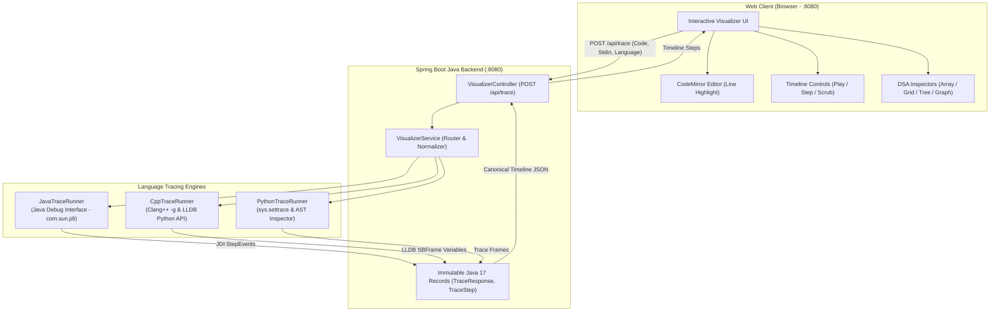

# ⚡ CodeTrace - Step-by-Step DSA Execution Visualizer

[](https://www.oracle.com/java/)
[](https://github.com/Rohithv07/codeVisualizer/actions/workflows/ci.yml)
[](https://spring.io/projects/spring-boot)
[](https://www.python.org/)
[](https://isocpp.org/)
[](LICENSE)

> **Visualize what your code is *actually* doing, step-by-step.**  
> Designed specifically for competitive programmers (Codeforces, LeetCode, CodeChef) who hit `Wrong Answer` and need to inspect variable states, array pointers, trees, and graphs without manual print debugging.

---

## 🌟 Why CodeTrace?

When solving DSA problems, logic bugs often hide in subtle index off-by-one errors, faulty pointer movements, or corrupted recurrence relations. 

**CodeTrace takes your raw source code and standard input (`stdin`), executes it deterministically, and records a complete time-travel trace:**
* Current executing line number
* Local variable states and mutations
* Dynamic pointer arrows above arrays (`left ↓`, `right ↓`, `mid ↓`)
* 2D dynamic programming grid matrices
* Linked lists with node chains and pointer badges (`head`, `curr`, `prev`)
* Hierarchical binary trees and N-ary trees with live recursion call stack path tracing
* Interactive SVG graph canvas with circular layout, edge weights, and live $(u \to v)$ traversal highlights
* Incremental program output (`stdout`) at each step

---

## 🏗️ Architecture & System Design



---

## 🚀 Key Features

### 1. Multi-Language Support
* **Java (JDK 17)**: Uses Java's native **Java Debug Interface (`com.sun.jdi`)** to step through bytecode line-by-line and inspect JVM stack frames, arrays, primitives, and object references without modifying the source code.
* **C++ (C++17)**: Compiles with `clang++ -g -O0` and orchestrates **LLDB** via its Python API to extract `std::vector`, raw arrays, pointers, and primitives.
* **Python (3.9+)**: Leverages `sys.settrace()` to capture local scopes, lists, dicts, sets, and custom classes.

### 2. Dual Platform Support: Codeforces & LeetCode
CodeTrace automatically detects the style of your code and adapts:
* **Competitive Programming Mode (Codeforces, AtCoder, CSES)**:
  * Full programs containing standard `main()` methods.
  * Reads from standard input (`cin`, `Scanner`, `sys.stdin`) and outputs to `stdout`.
* **LeetCode Mode (Function-Only `class Solution`)**:
  * You can paste pure `class Solution` code with **no `main()` method**.
  * Works across **Java, C++, and Python**.
  * **Supported Data Structures Out of the Box**:
    * **Graphs**: Multi-dimensional matrices and adjacency lists:
      ```text
      n = 3, edges = [[0,1,1],[1,2,1],[0,2,3]], labels = "aab", k = 1
      ```
    * **Binary Trees**: Level-order array representation:
      ```text
      root = [3, 9, 20, null, null, 15, 7]
      ```
    * **N-ary Trees**: LeetCode format with `null` group delimiters:
      ```text
      root = [1, null, 3, 2, 4, null, 5, 6]
      ```
    * **Linked Lists**: Node arrays:
      ```text
      head = [1, 2, 3, 4, 5]
      ```
    * **1D & 2D Arrays**: Named or newline-delimited inputs:
      ```text
      arr = [2, 1, 3, 5, 0, 1, 4], totalTime = 3
      ```
  * **Auxiliary Classes & Structs**: Helper classes (`class TreeNode`, `class ListNode`, `class Node`, `class Pair`, `struct Edge`) can be **kept, commented out (like on LeetCode/GFG), or omitted completely** — CodeTrace automatically provides or normalizes them across all 3 languages!
  * **Bracket-Balanced Tokenizer**: Uses an exact nesting depth scanner that robustly handles multi-dimensional arrays (`int[][]`, `int[][][]`), quoted strings containing commas, and arbitrary key-value assignments without truncation.
  * CodeTrace automatically synthesizes a driver `main()` method behind the scenes, instantiates your class, injects parsed parameters, and steps through your algorithm line by line.

### 3. Specialized DSA Inspectors
* **Interactive Graph Visualizer (Canvas & Adjacency List)**:
  * **Visual SVG Canvas**: Renders vertices and directed edges in a symmetrical circular layout. Displays edge weights and vertex character labels (`0 ('a')`).
  * **Live Traversal Highlights**:
    * **Active Node ($u$)**: Glowing amber circle with pulsating ping ring and `ACTIVE [u]` badge.
    * **Active Neighbor ($v$)**: Sky-blue circle with `NEIGHBOR [v]` badge.
    * **Active Edge ($u \to v$)**: Flowing animated dashed golden stroke with directional arrow.
    * **Visited / Settled Nodes**: Emerald green with shortest distance indicators (e.g. `d: 0`, `d: 1`, `d: 2`).
  * **Dual-View Toggle**: Switch between interactive SVG canvas and card-based adjacency list with a single click.
  * **Clean Workspace**: Automatically hides redundant raw `edges` 2D matrices when the visual graph is active.
* **Tree Visualizer (Binary & N-ary)**:
  * Automatically renders hierarchical tree structures for both binary trees (`left`, `right`) and N-ary trees (`children`).
  * Traces recursion stack paths: highlights active node, call stack ancestor path, visited nodes, and dynamic base case badges (`node == null`).
  * Automatically hides 1D array inspector during tree recursion to prevent screen clutter.
* **Linked List Visualizer**: Detects objects with `.next` pointers and displays linked node chains (`[val: 1 | next] → [val: 2 | next] → null`) with pointer badges (`head`, `curr`, `prev`).
* **Array & Two-Pointer Visualizer**: Automatically detects 1D arrays and points integer variables (like `i`, `j`, `left`, `right`, `low`, `high`, `mid`, `ans`) directly at their respective indices.
* **2D Grid & Matrix Visualizer**: Renders 2D arrays or DP matrices into an interactive table with hover cells.

### 4. UI Ergonomics & Viewport Stability
* **Zero-Jump Viewport Containment**: CodeMirror editor and visualizer panels scroll independently within a strict `100vh` viewport. Stepping through lines deep in large codebases (50–100+ lines) never causes the browser window to scroll or jump to the bottom.
* **Clean Code Workspace**: One-click "Clear" button to reset editor and inputs, clean starter templates for Java, C++, and Python, and live executing line indicators.

### 5. Built-in Safeguards
* **Step Limit Protection**: Halts execution if steps exceed a configurable ceiling (e.g., 1,000 steps), protecting against infinite loops.
* **Deadlock-Free Streaming**: Piped subprocesses stream stdout directly to temporary files, preventing OS pipe buffer deadlocks on large traces.

---

## 📂 Project Structure

```text
codeVisualizer/
├── backend/
│   ├── pom.xml                               # Maven build configuration (Java 17, Spring Boot 3)
│   └── src/
│       ├── main/
│       │   ├── java/com/visualizer/
│       │   │   ├── VisualizerApplication.java # Spring Boot Main
│       │   │   ├── controller/               # REST API (POST /api/trace, GET /api/health)
│       │   │   ├── model/                    # Java 17 Records (DTOs)
│       │   │   │   ├── TraceRequest.java
│       │   │   │   ├── TraceResponse.java
│       │   │   │   ├── TraceStep.java
│       │   │   │   ├── StackFrame.java
│       │   │   │   └── VariableValue.java
│       │   │   ├── runner/                   # Tracing runners
│       │   │   │   ├── LanguageRunner.java   # Common runner interface
│       │   │   │   ├── JavaTraceRunner.java  # JDI native debugger
│       │   │   │   ├── PythonTraceRunner.java
│       │   │   │   └── CppTraceRunner.java   # LLDB C++ tracer
│       │   │   └── service/                  # Visualizer service logic
│       │   └── resources/
│       │       ├── application.properties
│       │       └── static/index.html         # Interactive Single-Page Visualizer UI
│       └── test/java/com/visualizer/runner/
│           └── RunnerTest.java               # Automated test suites for Java, Python, C++
├── runners/
│   ├── python/
│   │   └── tracer.py                         # Standalone Python sys.settrace engine
│   └── cpp/
│       └── tracer.py                         # Standalone C++ LLDB debugger engine
├── mvnw                                      # Maven wrapper script
├── .gitignore
└── README.md
```

---

## ⚡ Quickstart

### Prerequisites
* **Java 17+** (JDK 17 LTS recommended)
* **Python 3.9+**
* **Clang / g++** (with LLDB installed, standard on macOS via Command Line Tools)

### 1. Clone & Run the Application

```bash
git clone git@github.com:Rohithv07/codeVisualizer.git
cd codeVisualizer

# Package the application
./mvnw -f backend/pom.xml clean package -DskipTests

# Start the Spring Boot server
java -jar backend/target/backend-1.0.0-SNAPSHOT.jar
```

Or run directly with Maven:
```bash
./mvnw -f backend/pom.xml spring-boot:run
```

### 2. Open the Visualizer
Open your browser and navigate to:
```
http://localhost:8080
```

1. Select your language (**Java**, **C++**, or **Python**) and paste your LeetCode solution or CP code.
2. Enter your test case (named parameters like `n = 3, edges = [[0,1,1],[1,2,1],[0,2,3]], labels = "aab", k = 1` or standard stdin) in the **Standard Input (stdin)** box.
3. Click **"Visualize Execution"**.
4. Use the **Play / Pause** buttons or **Arrow Keys (`←` / `→`)** to step through execution, scrub the timeline slider, and inspect the live visualizers!

---

## 🧪 Running Automated Tests

Run the test suite covering Java JDI, Python, and C++ tracing:

```bash
./mvnw -f backend/pom.xml test
```

---

## 🔌 API Reference

### Trace Execution
`POST /api/trace`

#### Request Body
```json
{
  "language": "python",
  "code": "n = int(input())\narr = [1, 2, 3]\nprint(sum(arr))",
  "input": "3",
  "maxSteps": 500
}
```

#### Response
```json
{
  "status": "SUCCESS",
  "language": "python",
  "totalSteps": 12,
  "stdout": "6\n",
  "steps": [
    {
      "step": 1,
      "line": 1,
      "event": "line",
      "function": "<module>",
      "callStack": [{ "function": "<module>", "line": 1 }],
      "variables": {
        "n": { "type": "int", "value": 3, "repr": "3" }
      },
      "stdoutDelta": "",
      "totalStdout": ""
    }
  ]
}
```

---

## 📄 License

This project is licensed under the [MIT License](LICENSE).

